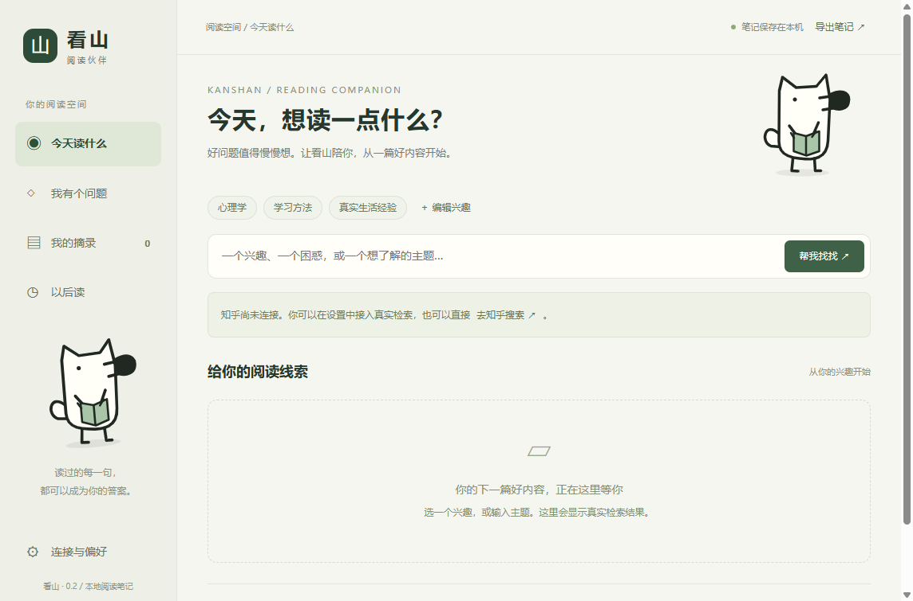

# 看山·阅读伙伴

Windows 桌面悬浮宠物 + Chrome/Edge 知乎阅读插件。当前为本地版 0.2，支持 AI 动态兴趣学习。

让每一次划线，都离自己的答案更近一点。



## 主要功能

- 按兴趣检索知乎内容，打开原文阅读，保存“以后读”与“不感兴趣”反馈。
- 在浏览器原文中划线、保存金句、批注和查看 AI 解释。
- 为一个实际问题收集资料，结合用户标注的态度与批注整理行动方案。
- 开启后用有限的阅读信号更新 AI 兴趣画像，支持查看依据、固定和纠正。
- 阅读笔记保存在本机，支持 Markdown 导出；模型与知乎凭证使用 Windows 加密存储。

仓库包含源码和浏览器插件。当前 Windows 程序包单独提供，不包含在 Git 历史中；如仓库尚无发布附件，请先按下方开发步骤本地运行。

## 直接使用

解压「看山阅读伙伴-Windows.zip」，双击其中 `Kanshan.exe`。请保留它旁边的所有文件。免安装，不需要 Node.js。

首次打开显示阅读面板与桌面看山。点击桌宠打开面板；拖动桌宠顶部的三个点移动它；右下角或右键菜单可暂时隐藏或退出。关闭阅读面板会保留桌宠。重新启动程序也能唤回面板。

## 安装浏览器插件（手动一次）

1. 在看山 →「连接与偏好」→「打开插件文件夹」。发布包内的位置是 `resources/extension`。
2. Chrome 打开 `chrome://extensions`，Edge 打开 `edge://extensions`。
3. 开启开发者模式 →「加载已解压的扩展程序」→ 选择上一步的 `extension` 文件夹。
4. 在看山设置里「复制本机连接码」，点击浏览器工具栏的看山插件，把码粘贴进去，点击连接。
5. 刷新已经打开的知乎页面。打开回答或文章，先展开你想阅读的原文，选中文字，就能划线批注、收藏金句、解释。

桌宠需保持运行；端口为本机 `127.0.0.1:47831`。连接失败时摘录不会假装保存成功，面板保留当前文字供重试。连接码不是知乎或模型的密钥，连接码只能交给你自己的插件。

## 连接知乎和 AI

在「连接与偏好」填写：

- 知乎 Access Secret：在 <https://developer.zhihu.com/profile> 获取。仅在主动检索时发送关键词给知乎；保留返回的真实原文链接。未连接时可直接跳转知乎搜索，自行阅读、划线。
- AI API 根地址：支持 Chat Completions 的服务地址，填写到 `/v1` 或服务商规定的 API 根路径；程序会追加 `/chat/completions`。
- 模型名和 API Key：使用你实际开通的模型服务。支持 HTTPS；本机模型可用 `http://127.0.0.1:端口/v1`。

设置中的“已配置”表示凭证已保存，并不表示已通过远端验证。实际搜索、解释时会显示服务连接与额度等错误。留空密钥会保留旧值；清除凭证按钮可移除已保存的服务密钥。

此交付不附带知乎或模型凭证。真实远端服务尚未在你的账户下联调；相关接口已按文档实现，并通过模拟服务进行请求与错误处理验证。服务可用性、配额和费用由你的服务商决定。

## AI 动态调整兴趣

1. 先配置模型的 API 根地址、模型名和 API Key。
2. 在“连接与偏好 → AI 动态兴趣”勾选“允许 AI 自动分析阅读信号并调整推荐”，再点击下方“保存连接与偏好”。默认关闭，不会自动为你开启。
3. 正常阅读和批注。至少来自两篇不同帖子的正向信号才能建立推断兴趣。每累计3次保存/修改摘录或反馈，自动分析一次；自动分析间隔至少30分钟。也可以用“预览并立即分析”手动触发。
4. AI 兴趣在首页以 ✦ 标记显示，会参与检索结果排序；无关键词时，也会用最近的学习兴趣与手动兴趣组合检索。
5. 每个主题展示理由与依据。判断正确可以“固定为我的兴趣”；判断不对可以删除，程序记住并排除这个同名主题。可以重置 AI 兴趣与排除列表。

模型只收到最近30天最多24条阅读信号：标题最多160字、原文前160字、批注前200字、态度、反馈摘要最多160字，以及现有兴趣主题与排除列表。不会发送全文、来源网址或浏览历史。自动分析会使用你配置的模型额度；开启一次后会按上述规则自动调用，不逐次弹确认。模型分析失败时保留旧画像，并显示错误；不会自动重试到突破30分钟间隔。

手动兴趣不会被 AI 覆盖；模型推断需要有效资料引用，疑问、不适合或不感兴趣不能作为新增兴趣的正向依据。兴趣权重随时间衰减，过期资料不参与推荐。关闭开关并保存后停止自动学习，已有画像继续参与推荐；如需移除可点“重置 AI 兴趣”。这是一套带证据约束的模型推断机制，仍可能误判，可以随时纠正。

## 两条阅读路径

### 兴趣阅读

设置兴趣 → 点击主题或输入关键词 → 找到真实知乎内容 → 打开原文 → 选中文字 → 填批注并保存。推荐采用人工兴趣、AI 从阅读信号推断的话题及“以后读/不感兴趣”反馈进行加权排序。

### 带着问题阅读

「我有个问题」→ 建立问题并补充限制 → 寻找相关帖子 → 插件保存摘录时选择该问题 → 回到问题笔记 → 勾选资料 →「根据选中摘录整理方案」→ 确认发送。

摘录可以标为“值得尝试 / 解释了原因 / 我有疑问 / 不适合我”。模型收到态度与批注，并被要求区分作者观点、用户判断、AI 推断和资料缺口。方案可修改，每次重新生成保留独立版本。每份方案保存本次引用的摘录快照；后续删除摘录不会使历史依据丢失。AI 输出仍需你核对，引用与结论的真实性不能仅靠提示词保证。

## 保存、隐私与导出

- 笔记与兴趣保存在 `%APPDATA%/kanshan-reading-companion/library.json`（开发与便携版共用当前账户数据）。模型密钥与知乎密钥保存在 `credentials.bin`，使用 Windows DPAPI 加密。
- 笔记本身是本地明文 JSON；没有云同步和自动备份。可用右上角「导出笔记」导出 Markdown（包含批注、解释、方案和依据快照），也可在退出后备份整个数据目录。凭证绑定 Windows 用户，跨设备迁移时重新填写。
- 插件仅在 `www.zhihu.com` 与 `zhuanlan.zhihu.com` 运行，不读取其他网站或全局浏览历史。
- 默认划线和批注只发送到本机服务；主动启用自动兴趣学习后，会按上面的规则发送有限信号给模型。点击 AI 解释时，发送所选原文、有限上下文、标题与批注给配置的模型；生成方案前桌面面板展示所选摘录，发送问题、限制、所选摘录及其作者/来源/批注。没有自动整页上传。
- 选中内容上限 12,000 字；批注上限 4,000 字；每次整理最多 30 条摘录。超长资料可能超出模型上下文，远端报错时可以减少选择。
- 按文字与前后文恢复划线。知乎动态加载、折叠全文、复杂排版或作者改文都可能使自动定位失败；原摘录仍保存。点击插件右下角「山·阅读伙伴」可重新定位、查看状态。返回原文时请先展开全文，再点该按钮。
- 浏览器扩展尚未在商店发布，需要手动加载。没有自动导入知乎历史收藏、账号 OAuth 登录、语音、装扮或跨设备同步。

## 开发与验证

需要 Node.js 22.23 或更新的兼容版本。执行：

```text
npm ci
npm start
npm test
npx electron tests/smoke.cjs
npm run package
```

- `interests.cjs`：有依据的 AI 兴趣推断、时效衰减、自动分析节流、用户纠正与退出控制。
- `service.cjs`：本机鉴权服务、JSON 数据持久化、知乎检索、AI 请求、问题与摘录。
- `main.cjs` / `preload.cjs`：Electron 窗口、DPAPI、受限 IPC、本机服务。
- `ui/`：桌宠动画与阅读工作台。
- `extension/`：Manifest V3 插件，service worker 持有本机连接码，内容脚本负责原文交互。
- `tests/`：数据持久化、鉴权、远端接口契约、引用快照、模拟知乎 DOM 的插件划线链路，以及真实 Electron 窗口内的表单操作测试。

UI 与插件测试使用临时合成数据，不会写入你的真实阅读库，窗口截图保存在 `work/test-results/`。已提供 GitHub Actions Windows 检查，包含自动化测试和 Electron 窗口测试。插件测试验证了 DOM 选择、问题关联、鉴权保存和高亮恢复；真实知乎登录页、折叠回答及浏览器扩展安装仍需在你的浏览器中验收。

安全设计参考：[Electron 上下文隔离](https://www.electronjs.org/docs/latest/tutorial/context-isolation)、[Chrome 扩展跨源请求](https://developer.chrome.com/docs/extensions/develop/concepts/network-requests)。知乎接口依据本机安装的官方知乎 Skill 中 HTTP API 文档实现。
